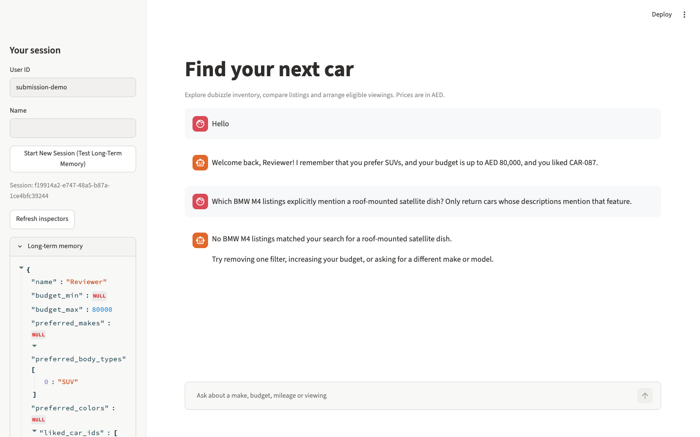

# Dubizzle Cars AI Assistant

A FastAPI and Streamlit prototype for exploring the supplied Dubizzle inventory, arranging eligible viewings, and recalling shopper preferences across sessions.

## Run locally

Requires Python 3.11–3.13, [uv](https://docs.astral.sh/uv/), and a Gemini API key from Google AI Studio.

```bash
git clone https://github.com/Shravan-prog/dubizzle-project.git
cd dubizzle-project
uv sync --locked
cp .env.example .env
# Windows PowerShell: Copy-Item .env.example .env
# Set GEMINI_API_KEY in .env.
uv run uvicorn main:app --host 127.0.0.1 --port 8000
```

In a second terminal in the same folder, run `uv run streamlit run app.py`. Open [Streamlit](http://localhost:8501) or [API docs](http://127.0.0.1:8000/docs). The repository includes `data/cars.csv`, so a fresh clone needs no conversion step. To rebuild that CSV from the workbook, run `uv run python scripts/prepare_data.py --force`. The default model is `gemini/gemini-3.5-flash-lite`. Set `LLM_MODEL` in .env to override it.

## Why this stack

Streamlit keeps the chat and memory inspector easy to try while FastAPI owns retrieval and writes. LiteLLM lets Gemini call typed tools without a separate orchestration framework. Pandas handles exact filters and BM25 searches listing text, which suits a 100-row dataset with structured and free-text fields. SQLite persists conversations and profiles, and CSV makes qualified leads easy to inspect.

## Design and scope

The app uses the workbook’s 100-row raw tab. The cleaned tab is a different sample. The raw tab has no dedicated price field, and the importer currently indexes 29 explicitly identified asking prices. A blank price stays unknown, and a price filter excludes it. Only the 10 listings with explicit Dubizzle management evidence are eligible for online viewing. The app explains unconfirmed eligibility and uses Monday–Saturday, 08:00–20:00 Dubai time for eligible listings. To try an eligible listing, ask for Dubizzle-managed cars or use CAR-060. Booking confirmation comes from the slot check, and Portalocker serializes CSV access.

This is a local prototype. Production work would include authenticated profiles, booking idempotency and integration with real schedules, stronger grounding for free-text claims, and more complete extraction of bilingual seller descriptions. The demo uses isolated local state and simulated bookings.

## Live conversation on the supplied inventory

Captured with the configured Gemini provider and the committed 100-row CSV. Gemini selected the Honda and BMW search tools. The backend rendered the Honda result when narration fell back, answered the direct follow-ups, and recalled the saved profile from SQLite in a different session.

### Explore the inventory

**User** · My name is Reviewer. Show me Honda cars.

> **Assistant**
>
> Found 1 matching listing.
>
> **Honda CR-V — 2021**
> **Trim:** ex-l  ·  **Listing ID:** `CAR-087`
>
> | Price | Mileage | Body type | Color | Warranty |
> |---|---|---|---|---|
> | Not listed | 79000 km | SUV | Not listed | Not listed |

**User** · What is the mileage of the first Honda?

> **Assistant**
>
> The listed mileage for the 2021 Honda CR-V is 79,000 km.

**User** · Does it have a warranty?

> **Assistant**
>
> Warranty information is not listed for the 2021 Honda CR-V.

**User** · Can I book a viewing for the first car?

> **Assistant**
>
> CAR-087 has unconfirmed Dubizzle management. Online viewings require a confirmed Dubizzle-managed listing.

**User** · Remember that I prefer SUVs under AED 80,000 and I like CAR-087.

> **Assistant**
>
> I have saved your preference for SUVs under AED 80,000 and noted that you like CAR-087.

### Recall in a new session

**User** · Hello

> **Assistant**
>
> Welcome back, Reviewer! I remember that you prefer SUVs, and your budget is up to AED 80,000, and you liked CAR-087.

**User** · Which BMW M4 listings explicitly mention a roof-mounted satellite dish? Only return cars whose descriptions mention that feature.

> **Assistant**
>
> No BMW M4 listings matched your search for a roof-mounted satellite dish.
>
> Try removing one filter, increasing your budget, or asking for a different make or model.



## Verification

```bash
uv run pytest -q
uv run python scripts/evaluate_rag.py
uv run python scripts/demo_logs.py
```

The scripted evaluation passes all 17 cases, including S03 for the lowest indexed asking price. The two [deterministic integration demos](logs/demo_transcripts.md) use a synthetic fixture for repeatability. See the [evaluation report](logs/rag_eval_report.md) for separately recorded live and scripted scores.
